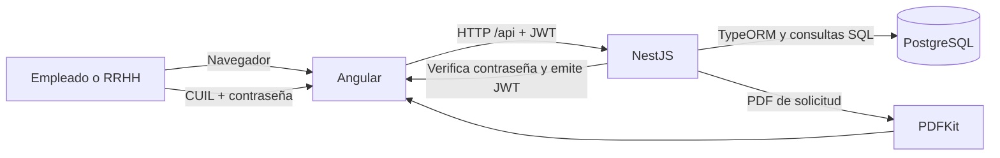
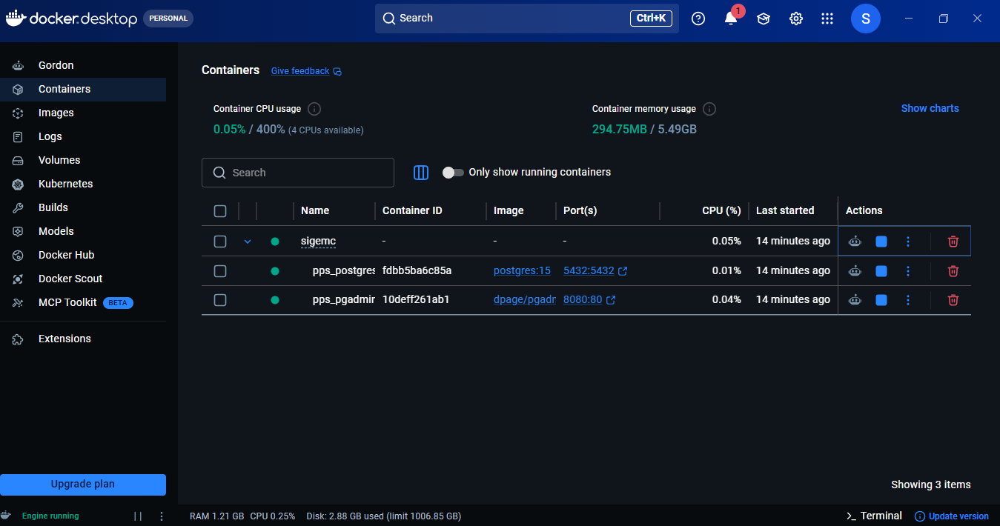
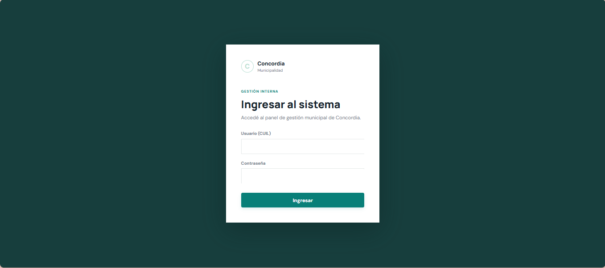
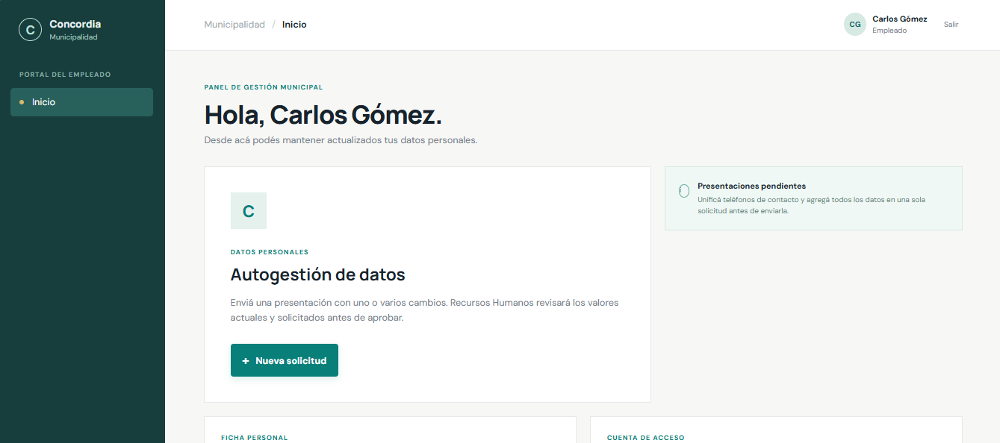
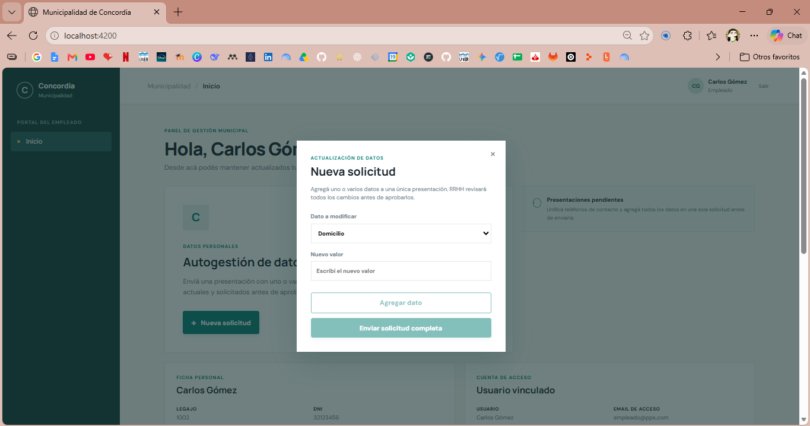
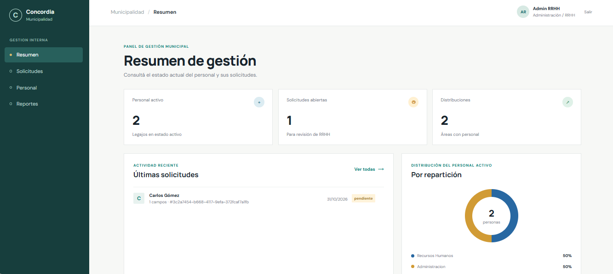

# Sistema de Autogestión de Datos — Municipalidad de Concordia

Portal web y API para que el personal municipal presente solicitudes de actualización de datos de su legajo y para que Recursos Humanos las revise, apruebe o rechace.

> Proyecto de Práctica Profesional Supervisada (PPS), Licenciatura en Sistemas, UNER. El acceso se realiza con el CUIL y una contraseña asignada a cada cuenta activa vinculada a un legajo.

## Objetivo

Digitalizar la presentación y revisión de cambios de datos personales asociados a un legajo, conservando los valores anteriores y registrando la decisión de RRHH.

## Funcionalidades implementadas

| Perfil | Funcionalidades |
|---|---|
| Empleado | Consultar su ficha y cuenta vinculada; preparar una solicitud con uno o varios cambios y enviarla para revisión. |
| RRHH | Ver resumen, consultar/buscar personal, revisar solicitudes pendientes, aprobarlas o rechazarlas con motivo y generar un PDF de una solicitud. |

Los cambios que pueden solicitarse incluyen domicilio, teléfonos, correo electrónico, repartición, función, estado civil, familiares, foto y situación/documentación de CUD. La solicitud queda pendiente hasta que RRHH la resuelva. La interfaz del empleado no incluye un historial o seguimiento de solicitudes enviadas.

## Tecnologías

| Capa | Tecnología |
|---|---|
| Frontend | Angular 20, TypeScript, RxJS, SCSS |
| Backend | Node.js, NestJS 12, TypeScript, Passport/JWT |
| Persistencia | PostgreSQL 15, TypeORM |
| Validación y reportes | class-validator, class-transformer, PDFKit |
| Desarrollo y pruebas | npm, Vitest, Supertest, Docker Compose |

## Arquitectura general



La API verifica el hash de la contraseña asociado al usuario vinculado al legajo del CUIL y emite un JWT firmado. Angular conserva el token en memoria durante la sesión. En desarrollo, el frontend se sirve en `http://localhost:4200` y su proxy reenvía `/api` a `http://localhost:3000`. Las secciones de la interfaz se muestran mediante estado del componente, no mediante rutas de Angular.

## Estructura del repositorio

```text
.
├── README.md
├── docker-compose.yml            # PostgreSQL y pgAdmin; no incluye la aplicación
├── pps_db.sql                    # Esquema base de la base municipal
├── backend/
│   ├── migrations/               # Solicitudes, catálogos y datos de rechazo
│   ├── scripts/                  # Herramienta de claves y JWT de prueba
│   ├── src/
│   │   ├── auth/                 # Login CUIL/contraseña, hashes y estrategia JWT
│   │   ├── common/               # Guards, decoradores y validadores
│   │   ├── empleados/            # Consultas de legajos
│   │   ├── reportes/             # PDF de solicitudes
│   │   └── solicitudes/          # DTOs, entidades, flujo de solicitudes
│   └── test/                     # Pruebas e2e
├── frontend/
│   └── src/app/
│       ├── auth/                 # Ingreso con CUIL y contraseña
│       ├── core/                 # Servicios e interceptor HTTP
│       ├── employee/             # Portal del empleado
│       └── hr/                   # Panel de RRHH
└── docs/
    ├── DESPLIEGUE.md
    ├── MANUAL_USUARIO.md
    ├── DOCUMENTACION_TECNICA.md
    ├── CAPTURAS.md
    └── img/
```

## Requisitos

- Node.js 22 LTS recomendado (los manifiestos no fijan `engines`) y npm.
- Docker Desktop con Docker Compose, o PostgreSQL 15 accesible desde el backend.
- Un secreto `JWT_SECRET` para desarrollo o un par de claves JWT RS256 para producción.
- Para abrir el PDF, un navegador que permita ventanas emergentes para el sitio.

## Instalación y configuración local

1. Clonar el repositorio y abrir una terminal en la raíz.
2. Iniciar la base local:

   ```powershell
   docker compose up -d postgres pgadmin
   ```

   En la primera inicialización del volumen, Compose ejecuta `pps_db.sql` y las cinco migraciones en orden. Los scripts de inicialización no se vuelven a ejecutar en volúmenes ya creados.

3. Crear `backend/.env` manualmente. El repositorio **no contiene** `backend/.env.example`. Ejemplo para desarrollo:

   ```dotenv
   NODE_ENV=development
   PORT=3000
   DB_HOST=localhost
   DB_PORT=5432
   DB_USERNAME=pps_user
   DB_PASSWORD=pps_password
   DB_NAME=pps_db
   JWT_SECRET=reemplazar-por-un-secreto-local
   JWT_MAX_AGE=1h
   CORS_ORIGINS=http://localhost:4200,http://127.0.0.1:4200
   JSON_BODY_LIMIT=8mb
   ```

   En desarrollo se puede usar `JWT_SECRET` para HS256. Para RS256 se deben configurar tanto `JWT_PUBLIC_KEY` como `JWT_PRIVATE_KEY`. No compartir ni publicar credenciales o tokens.

   En bases existentes, aplicar también `backend/migrations/005_add_password_hash.sql` antes de iniciar la API. Asociar primero cualquier cuenta RRHH que todavía no tenga un vínculo activo en `usuarioslegajos`; cargar un CUIL faltante en el empleado antes de intentar habilitarlo.

4. Instalar dependencias y arrancar la API:

   ```powershell
   cd backend
   npm ci
   npm run auth:set-password
   npm run start:dev
   ```

   `auth:set-password` pide CUIL y contraseña en una terminal interactiva, oculta la contraseña y almacena únicamente su hash. Solo habilita cuentas activas asociadas de forma única a un legajo activo con ese CUIL.

5. En otra terminal, arrancar el portal:

   ```powershell
   cd frontend
   npm ci
   npm start
   ```

6. Abrir `http://localhost:4200`. La API escucha en `http://localhost:3000`; pgAdmin queda en `http://localhost:8080`.

La tabla de variables, despliegue completo, operación con la base y solución de problemas están en [docs/DESPLIEGUE.md](docs/DESPLIEGUE.md).

## Publicación para evaluación

El repositorio incluye [render.yaml](render.yaml) para desplegar temporalmente en Render un sitio, una API y una base gratuita. Todavía no hay una URL publicada: es necesario conectar GitHub, crear el Blueprint en Render, cargar una base ficticia y provisionar las cuentas de prueba. La API gratuita puede tardar en despertar y PostgreSQL gratuito expira a los 30 días. Los pasos están en [docs/DESPLIEGUE.md](docs/DESPLIEGUE.md).

## Variables de entorno

| Variable | Uso y valor predeterminado |
|---|---|
| `PORT` | Puerto de la API; `3000`. |
| `DB_HOST`, `DB_PORT`, `DB_USERNAME`, `DB_PASSWORD`, `DB_NAME` | Conexión PostgreSQL. En desarrollo: `localhost`, `5432`, `pps_user`, `pps_password`, `pps_db`. En producción las variables de host, usuario, contraseña y base son obligatorias. |
| `JWT_PUBLIC_KEY` | Clave pública del emisor para verificar tokens asimétricos; tiene precedencia sobre `JWT_SECRET`. Acepta saltos de línea escapados como `\n`. |
| `JWT_PRIVATE_KEY` | Clave privada correspondiente a `JWT_PUBLIC_KEY`, necesaria para emitir tokens de login RS256. Mantenerla solo en el entorno del backend. |
| `JWT_SECRET` | Secreto compartido para verificar tokens HS256 (desarrollo/pruebas). |
| `JWT_ALGORITHM` | Algoritmo(s) permitidos separados por coma; predeterminado `RS256` con clave pública o `HS256` con secreto. Debe concordar con el emisor. |
| `JWT_MAX_AGE` | Antigüedad máxima del token; predeterminado `1h`. El JWT también debe tener `exp`. |
| `CORS_ORIGINS` | Orígenes web permitidos separados por coma. En producción es obligatorio; en desarrollo permite localhost:4200. |
| `DB_SSL` | Con `true`, activa TLS para conexiones PostgreSQL desde herramientas locales; no se configura en la API de Render, que usa la conexión interna. |
| `JSON_BODY_LIMIT` | Límite del cuerpo JSON; `8mb`. |
| `NODE_ENV` | El modo `production` exige la configuración de base y `CORS_ORIGINS`. |
| `PGADMIN_DEFAULT_EMAIL`, `PGADMIN_DEFAULT_PASSWORD` | Credenciales de pgAdmin en Compose; valores locales predeterminados en `docker-compose.yml`. |

## Ejecución mediante Docker

El archivo `docker-compose.yml` **no construye ni ejecuta imágenes del frontend o backend**. Solo inicia PostgreSQL 15 y pgAdmin. La aplicación se inicia con npm en el host, como en los pasos anteriores. Puertos 5432 y 8080 se publican en loopback (`127.0.0.1`).



```powershell
docker compose up -d postgres pgadmin
docker compose ps
```

Ver instrucciones, conexión, persistencia y límites de este modo en [docs/DESPLIEGUE.md](docs/DESPLIEGUE.md#docker).

## Usuarios y roles

| Rol esperado en el JWT | Uso |
|---|---|
| `RRHH` (también se normalizan los identificadores `1`, `RRHH-ADMIN` y `ADMIN`) | Acceso a directorio, bandeja, aprobación/rechazo y reportes. |
| `EMPLEADO` (también se normaliza el identificador `2`) | Acceso a ficha propia y creación de solicitudes, siempre que el usuario esté vinculado a un legajo activo. |

El campo **Usuario** del login es el CUIL del empleado y la contraseña se asigna por cuenta con `npm run auth:set-password` desde `backend/`. La aplicación guarda hashes scrypt en `usuarios.password_hash`, no contraseñas en texto. Se requiere una sola cuenta activa vinculada a un legajo activo con ese CUIL; las cuentas sin vínculo (incluidas las cuentas RRHH no asociadas) no pueden iniciar sesión hasta que se cargue la relación correcta en `usuarioslegajos`. Los roles se obtienen de `usuarios.idrol`; `1` da acceso a RRHH y `2` al portal de empleado. Los scripts `npm run token:rrhh`, `npm run token:empleado` y `npm run token:ana` se conservan para pruebas locales de API; requieren `JWT_SECRET` y rechazan `NODE_ENV=production`.

El CUIL puede ingresarse con o sin separadores (guiones, puntos o espacios); el login comprueba el formato de 11 dígitos, no que el CUIL exista ni su dígito verificador. El nombre que aparece en el portal se forma con nombre y apellido de la cuenta vinculada. Para la base local de pruebas, los roles y vínculos vigentes se consultan en `usuarios`, `roles` y `usuarioslegajos`. Para evaluar ambos perfiles, preparar una cuenta de prueba vinculada para Empleado y otra para RRHH, asignarles contraseñas con la herramienta de backend y entregar al evaluador la URL, el CUIL y la contraseña por un canal privado. Las credenciales no se publican en este README. Para restablecer o rotar una contraseña, volver a ejecutar `npm run auth:set-password` y asignarla de nuevo de forma interactiva.

`pps_db.sql` es el esquema y los datos de inicio, no un respaldo actualizado de lo editado después en pgAdmin. No hace falta volver a subirlo para conservar cambios en la base actual: quedan en PostgreSQL. Para que el evaluador pueda ingresar desde una instalación nueva, preparar en esa base los legajos ficticios, CUIL y vínculos necesarios para ambos roles; luego asignar las contraseñas en ese entorno con la herramienta y compartir esos datos por privado. No copiar hashes ni claves al repositorio.

## Endpoints principales

Todos los endpoints están bajo `/api`. Salvo `GET /health` y `POST /auth/login`, requieren `Authorization: Bearer <JWT>`.

| Método y ruta | Acceso | Propósito |
|---|---|---|
| `GET /api/health` | Público | Comprobación básica de disponibilidad de la API. |
| `POST /api/auth/login` | Público | Validar CUIL y contraseña, y emitir un JWT. |
| `GET /api/auth/profile` | JWT válido | Validar token y devolver perfil normalizado. |
| `GET /api/empleados/me` | JWT válido | Obtener ficha del legajo vinculado al usuario. |
| `GET /api/empleados?q=texto` | RRHH | Listar y filtrar empleados por nombre/apellido. |
| `GET /api/empleados/:id` | RRHH | Consultar ficha por legajo. |
| `GET /api/solicitudes/catalogos` | JWT válido | Obtener reparticiones, funciones, parentescos y estados civiles del formulario. |
| `POST /api/solicitudes` | JWT válido + legajo vinculado | Crear solicitud con uno o más cambios. |
| `GET /api/solicitudes?estado=pendiente` | RRHH | Listar solicitudes pendientes; `estado=all` incluye todos los estados. |
| `GET /api/solicitudes/:id` | RRHH | Consultar una solicitud. |
| `PATCH /api/solicitudes/:id/aprobar` | RRHH | Aplicar los cambios y registrar aprobación/observación. |
| `PATCH /api/solicitudes/:id/rechazar` | RRHH | Rechazar y registrar un motivo obligatorio. |
| `GET /api/reportes/solicitud/:id/pdf` | RRHH | Generar el detalle PDF para imprimir. |

Ejemplo de creación:

```http
POST /api/solicitudes
Authorization: Bearer <TOKEN>
Content-Type: application/json

{"cambios":{"domicilio":"Calle de ejemplo 123","email":"persona@example.org"}}
```

## Capturas

Las imágenes originales se conservan en `docs/img/`; véanse [docs/CAPTURAS.md](docs/CAPTURAS.md) para el inventario y la ubicación sugerida. Los nombres, correos, legajos, fechas, identificadores y motivos visibles en las capturas del sistema son datos ficticios inventados para demostración. En la captura de la consola del frontend se ocultó únicamente la ruta local que identificaba al usuario del equipo; las capturas que mostraban JWT completos no se incluyeron porque los tokens son credenciales.

### Acceso



La captura de error de acceso también está disponible en [docs/img/login-error.png](docs/img/login-error.png).

### Portal del empleado





### Gestión de RRHH



## Problemas conocidos y límites documentados

- No hay alta de usuarios ni cambio/restablecimiento de contraseñas desde el portal; la administración de claves requiere la herramienta de backend y una cuenta vinculada.
- El empleado puede ver su ficha y enviar solicitudes, pero no dispone de una pantalla de historial/estado de sus presentaciones.
- El Compose actual no empaqueta frontend ni backend y no define una topología de producción.
- La carga de archivos se guarda en PostgreSQL (`bytea`); conviene evaluar almacenamiento de objetos para un uso de mayor volumen.

## Trabajo futuro (no implementado aún)

- Agregar historial y consulta de estado de solicitudes para el empleado.
- Incorporar pruebas de interfaz y pruebas visuales automatizadas.
- Más funcionalidades, opciones.

## Autoría

Proyecto de PPS de la Licenciatura en Sistemas (UNER). Realizado por Sofía Belén Guardia, estudiante avanzada de la carrera.

## Documentación

- [Guía de despliegue](docs/DESPLIEGUE.md)
- [Manual de usuario](docs/MANUAL_USUARIO.md)
- [Documentación técnica](docs/DOCUMENTACION_TECNICA.md)
- [Capturas y diagramas](docs/CAPTURAS.md)
