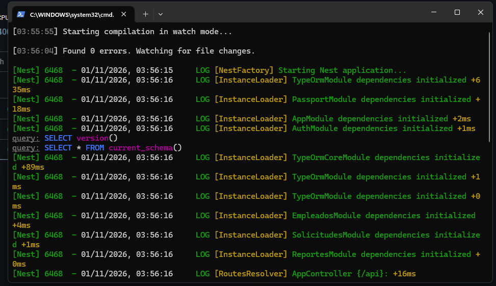
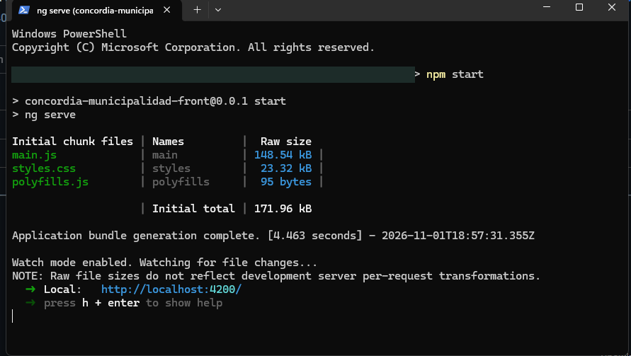
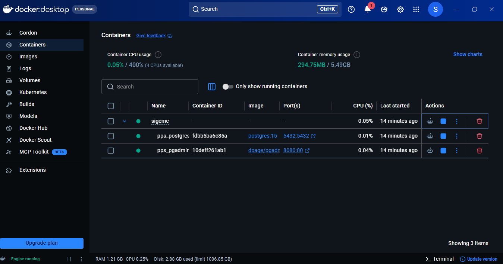

# Guía de despliegue

## Introducción

Este documento describe cómo preparar y ejecutar el sistema de autogestión de datos de la Municipalidad de Concordia desde el código del repositorio. La modalidad actualmente configurada es de desarrollo: Docker Compose ejecuta PostgreSQL y pgAdmin, mientras que API y frontend se ejecutan con Node.js/npm en el host.

No hay `Dockerfile` para la API o el portal ni servicios de aplicación en `docker-compose.yml`; por ello, el despliegue integral de producción requiere definir esa infraestructura por separado.

## Requisitos de hardware

No existe una especificación de dimensionamiento medida o declarada por el proyecto. Para desarrollo local se recomienda:

| Recurso | Recomendación práctica |
|---|---|
| CPU | 2 núcleos o más |
| Memoria | 8 GB o más para IDE, Node.js y PostgreSQL simultáneos |
| Almacenamiento | Espacio para dependencias, imágenes y volumen persistente de PostgreSQL; el consumo depende de los datos y archivos cargados. |
| Red | Acceso local a los puertos 3000, 4200, 5432 y 8080 según los servicios que se utilicen. |

Estas cifras son una recomendación de desarrollo, no un requisito validado de producción.

## Requisitos de software

- Node.js 22 LTS recomendado y npm.
- Docker Desktop y Docker Compose v2 para levantar PostgreSQL y pgAdmin, o PostgreSQL 15 instalado/accesible.
- Emisor externo de JWT compatible con el algoritmo configurado.
- Git para obtener el proyecto.
- Navegador moderno; permitir ventanas emergentes para abrir el PDF de RRHH.

Los `package-lock.json` de frontend y backend permiten instalar versiones reproducibles mediante `npm ci`.

## Dependencias

| Servicio | Puerto local | Uso |
|---|---:|---|
| API NestJS | 3000 | REST bajo `/api`. |
| Angular CLI | 4200 | Servidor de desarrollo; proxy `/api` hacia la API. |
| PostgreSQL 15 | 5432 | Persistencia de legajos y solicitudes. |
| pgAdmin | 8080 | Administración de PostgreSQL. |

El Compose publica PostgreSQL y pgAdmin en `127.0.0.1`, no en todas las interfaces de red. Los puertos de API y frontend corresponden a procesos locales y siguen la configuración de sus herramientas.

## Configuración de base de datos

### Opción A: Docker Compose

Desde la raíz:

```powershell
docker compose up -d postgres pgadmin
docker compose ps
```

La primera inicialización de `postgres_data` ejecuta, en este orden:

1. `pps_db.sql`: estructura municipal base.
2. `backend/migrations/001_create_solicitudes.sql`: tabla de solicitudes y columnas complementarias.
3. `backend/migrations/002_seed_catalogos.sql`: catálogos iniciales.
4. `backend/migrations/003_add_rejection_details.sql`: datos de rechazo.
5. `backend/migrations/004_normalize_catalogos.sql`: elimina acentos y consolida funciones/parentescos duplicados conservando sus referencias.
6. `backend/migrations/005_add_password_hash.sql`: agrega el hash de contraseña a las cuentas.

La imagen oficial ejecuta scripts de `/docker-entrypoint-initdb.d` solamente cuando inicializa un directorio de datos vacío. Si el volumen ya existe, actualizar los archivos SQL no vuelve a ejecutar las migraciones. Para una base existente, realizar copia de seguridad y aplicar manualmente cada migración pendiente con `psql` en el orden indicado, incluida `004_normalize_catalogos.sql` para normalizar datos ya cargados y `005_add_password_hash.sql` para habilitar el login; no eliminar el volumen como método de actualización.

Para aplicar esta migración en el PostgreSQL de Compose desde PowerShell, una vez hecha la copia de seguridad:

```powershell
Get-Content backend/migrations/005_add_password_hash.sql | docker compose exec -T postgres psql -U pps_user -d pps_db
```

Para conectarse desde pgAdmin, crear un servidor con host `postgres`, puerto `5432`, base `pps_db`, usuario `pps_user` y la contraseña definida en `docker-compose.yml`. Desde el host, el host de base de datos es `localhost`.

> El Compose deja `POSTGRES_PASSWORD=pps_password` fijo en el archivo. Es una contraseña de desarrollo: cambiar y parametrizar antes de un despliegue compartido o productivo. Los valores predeterminados de pgAdmin también son exclusivamente locales.

### Opción B: PostgreSQL instalado

1. Crear la base `pps_db` y un usuario con permisos sobre ella.
2. Cargar `pps_db.sql`.
3. Aplicar una sola vez, en orden, las migraciones `backend/migrations/001...` a `005...`.
4. Configurar `DB_HOST`, `DB_PORT`, `DB_USERNAME`, `DB_PASSWORD` y `DB_NAME` en el entorno de la API.
5. Confirmar conectividad desde el host donde se ejecutará NestJS.

TypeORM tiene `synchronize: false`: no crea ni actualiza automáticamente el esquema. Las migraciones anteriores se suministran como SQL y no hay un comando de migración integrado en los scripts npm.

## Variables de entorno

El archivo `backend/.env.example` no existe en el repositorio. Crear `backend/.env` localmente y no subir secretos al control de versiones. Ejemplo orientativo para desarrollo:

```dotenv
NODE_ENV=development
PORT=3000
DB_HOST=localhost
DB_PORT=5432
DB_USERNAME=pps_user
DB_PASSWORD=pps_password
DB_NAME=pps_db
JWT_SECRET=definir-un-secreto-local-seguro
JWT_MAX_AGE=1h
CORS_ORIGINS=http://localhost:4200,http://127.0.0.1:4200
JSON_BODY_LIMIT=8mb
```

| Variable | Descripción |
|---|---|
| `PORT` | Puerto de escucha de NestJS; predeterminado `3000`. |
| `DB_HOST`, `DB_PORT`, `DB_USERNAME`, `DB_PASSWORD`, `DB_NAME` | Parámetros de PostgreSQL. En modo producción se exigen host, usuario, contraseña y nombre. |
| `JWT_PUBLIC_KEY` | Clave pública para validar JWT asimétricos. Si se configura, prevalece sobre `JWT_SECRET`; los saltos de línea escapados (`\n`) se normalizan. |
| `JWT_PRIVATE_KEY` | Clave privada correspondiente a `JWT_PUBLIC_KEY`, necesaria para firmar tokens de login RS256. |
| `JWT_SECRET` | Secreto compartido para firmar y validar JWT HS256. Necesario para login local cuando no se usa un par RS256. |
| `JWT_ALGORITHM` | Lista separada por comas de algoritmos aceptados. Predeterminado `RS256` si hay clave pública o `HS256` si hay secreto. Alinear con el proveedor. |
| `JWT_MAX_AGE` | Antigüedad máxima admitida; predeterminada `1h`. Se exige además el claim `exp`. |
| `CORS_ORIGINS` | Lista de orígenes permitidos, separada por comas. Obligatoria cuando `NODE_ENV=production`; el valor predeterminado de desarrollo admite localhost:4200. |
| `JSON_BODY_LIMIT` | Límite de cuerpo JSON; predeterminado `8mb`. |
| `NODE_ENV` | Al establecer `production`, se aplican las comprobaciones de configuración productiva. |
| `PGADMIN_DEFAULT_EMAIL`, `PGADMIN_DEFAULT_PASSWORD` | Credenciales de pgAdmin interpretadas por Docker Compose; se usan defaults locales en el YAML. |

Para producción, usar el par RS256: `JWT_PUBLIC_KEY` para verificar y `JWT_PRIVATE_KEY` para firmar los tokens del login. Gestionar los secretos en el entorno del despliegue, no en Git ni en el frontend. El script de token de prueba solo acepta `JWT_SECRET`.

## Backend

Desde `backend/`:

### Instalar dependencias

```powershell
npm ci
```

### Habilitar cuentas existentes

Después de aplicar la migración `005_add_password_hash.sql`, asignar una contraseña a cada cuenta activa:

```powershell
npm run auth:set-password
```

El comando solicita CUIL y contraseña (mínimo 12 caracteres) sin mostrar esta última y almacena un hash scrypt en `usuarios.password_hash`. Solo procede si existe exactamente una cuenta activa, con vínculo activo en `usuarioslegajos`, para un empleado activo con ese CUIL. Antes de habilitar una cuenta RRHH, asociarla al legajo correcto; no se crean asociaciones automáticamente.

Para cambiar una contraseña existente, se puede volver a ejecutar el comando para el mismo CUIL; el hash anterior se reemplaza. Usar contraseñas únicas y no copiarlas a documentación, capturas, scripts ni al repositorio.

`pps_db.sql` se utiliza como carga inicial; no incorpora automáticamente los cambios hechos luego en pgAdmin. No hace falta exportarlo de nuevo para conservar la base local existente. En una instalación nueva, aplicar las migraciones y repetir únicamente los vínculos/datos de prueba necesarios; provisionar las contraseñas de forma local con el comando anterior.

Para comprobar qué cuentas activas tienen vínculo y contraseña configurada, sin exponer el hash, se puede usar en pgAdmin:

```sql
SELECT u.usucodigo, u.apenom, r.descripcion AS rol, ul.legajo,
       (u.password_hash IS NOT NULL) AS password_configurada
FROM public.usuarios u
JOIN public.roles r ON r.idrol = u.idrol
JOIN public.usuarioslegajos ul ON ul.usucodigo = u.usucodigo
WHERE u.estado = 'AC' AND ul.estado = 'AC'
ORDER BY u.usucodigo;
```

Los roles de la base son `1 = RRHH` y `2 = empleado`. Evitar registrar aquí CUIL o contraseñas reales.

### Preparar accesos para evaluación

La aplicación admite los perfiles Empleado y RRHH. Para que otra persona pueda probarlos:

1. Preparar en la base de evaluación un legajo ficticio activo con CUIL para Empleado y una cuenta activa con `idrol = 2`, vinculada a ese legajo en `usuarioslegajos`.
2. Preparar otra cuenta activa con `idrol = 1`, vinculada a un legajo activo con un CUIL único. No vincular ambos usuarios al mismo CUIL: el login exige que cada CUIL resuelva una sola cuenta activa.
3. Ejecutar `npm run auth:set-password` una vez por cada CUIL y configurar contraseñas temporales, únicas y distintas.
4. Entregar al evaluador la URL de la aplicación y las dos combinaciones de CUIL/contraseña por un canal privado separado del repositorio. Cambiar esas claves al terminar la evaluación o si se divulgaron.

El evaluador debe contar también con el entorno iniciado y configurado según esta guía. `pps_db.sql` sirve como base inicial y no contiene automáticamente los cambios hechos luego desde pgAdmin; una instalación nueva requiere reproducir allí los datos/vínculos de evaluación y asignar sus contraseñas.

### Compilar

```powershell
npm run build
```

La salida se genera en `backend/dist/`.

### Ejecutar

Desarrollo con recarga:

```powershell
npm run start:dev
```

Producción, luego de compilar y proporcionar las variables:

```powershell
$env:NODE_ENV = "production"
npm run start:prod
```

`npm run start:prod` ejecuta `node dist/main`. En producción se debe configurar CORS, la base y JWT antes de arrancar; no existe un gestor de procesos o servicio de sistema incluido.



### Login con CUIL y contraseña

El login de la interfaz usa `POST /api/auth/login`. El usuario ingresa el CUIL del legajo y la contraseña previamente asignada con `npm run auth:set-password`. Para utilizar herramientas de prueba de API, también se conservan los generadores JWT locales:

```powershell
npm run token:rrhh
npm run token:empleado
npm run token:ana
```

Los tokens generados son HS256, no funcionan con `NODE_ENV=production` ni con solo `JWT_PUBLIC_KEY`, y no deben usarse fuera de desarrollo.

## Frontend

Desde `frontend/`:

### Instalar dependencias

```powershell
npm ci
```

### Compilar

```powershell
npm run build
```

Angular aplica la configuración de producción por defecto; la salida se dirige a `frontend/dist/concordia-municipalidad-front/`. El servidor de producción para esos archivos no está incluido en el repositorio.

### Ejecutar

```powershell
npm start
```

Abrir `http://localhost:4200`. `src/proxy.conf.json` reenvía las solicitudes `/api` a `http://localhost:3000`; el proxy es parte del servidor Angular de desarrollo.



## Docker

### docker compose

El Compose define exclusivamente los servicios `postgres` y `pgadmin`, más el volumen nombrado `postgres_data`. No existe una configuración de compilación o ejecución Docker para `backend` o `frontend`.

```powershell
docker compose up -d postgres pgadmin
docker compose ps
docker compose logs -f postgres
```



`docker compose down` detiene los servicios, pero conserva el volumen nombrado. Evitar `docker compose down -v` salvo que se haya decidido explícitamente borrar los datos persistidos.

### Construcción de imágenes

Compose obtiene `postgres:15` y `dpage/pgadmin4` desde sus imágenes declaradas. No hay `Dockerfile` de la aplicación ni servicios que ejecutar con `docker compose build`; por tanto, el portal y la API se compilan con npm en el host.

### Despliegue disponible

La puesta en marcha local completa combina los contenedores de base de datos con dos procesos npm:

1. `docker compose up -d postgres pgadmin`.
2. Configurar `backend/.env`.
3. En una terminal, ejecutar `cd backend; npm ci; npm run start:dev`.
4. En otra terminal, ejecutar `cd frontend; npm ci; npm start`.
5. Abrir `http://localhost:4200`.

Para producción, además de compilar, faltan en este repositorio las imágenes de aplicación, servidor web para el artefacto Angular, proxy/TLS, administración de secretos, estrategia de migraciones y política de backup/restore. No asumir que el Compose actual despliega esos elementos.

## Verificación

1. Comprobar contenedores: `docker compose ps`.
2. Comprobar API: abrir `http://localhost:3000/api/health` o ejecutar:

   ```powershell
   curl.exe http://localhost:3000/api/health
   ```

3. Comprobar portal: abrir `http://localhost:4200`; debe aparecer la pantalla de ingreso.
4. Probar el login con un CUIL activo y su contraseña asignada; verificar la ficha o panel correspondiente al rol.
5. Para una prueba funcional completa, crear una solicitud como empleado, comprobar su aparición en la bandeja de RRHH, aprobarla o rechazarla y generar un PDF.
6. Los scripts de validación disponibles en backend son:

   ```powershell
   cd backend
   npm test
   npm run test:e2e
   npm run build
   ```

   Para validar el frontend: desde `frontend/`, `npm run build`. La presencia de scripts no implica que estas verificaciones se hayan ejecutado en esta documentación.

## Solución de problemas

| Síntoma | Causa probable | Acción |
|---|---|---|
| API no conecta con PostgreSQL | Base detenida, credenciales incorrectas o `DB_HOST` inadecuado. | Revisar `docker compose ps`, logs del servicio y variables; para backend ejecutado en host, usar `DB_HOST=localhost`. |
| Cambios SQL no aparecen en la base | El volumen ya estaba inicializado. | Revisar historial/manualidad de migraciones y aplicar las pendientes de forma controlada. Los init scripts no se reejecutan automáticamente. |
| Error por variable JWT ausente | No se configuró la clave/secreto. | Definir `JWT_SECRET` para HS256 o `JWT_PUBLIC_KEY` y `JWT_PRIVATE_KEY` para RS256. |
| Login rechazado | CUIL/contraseña incorrectos, cuenta inactiva, CUIL sin legajo o más de una cuenta activa vinculada. | Revisar estado y vínculo en `usuarioslegajos`, verificar el CUIL del empleado y asignar una clave con `npm run auth:set-password`. |
| JWT rechazado | Firma, expiración, algoritmo, antigüedad o claims incompatibles. | Confirmar `exp`, `sub`/`id`/`usuCodigo`, rol, `JWT_ALGORITHM`, `JWT_MAX_AGE` y el secreto o par de claves configurado. |
| CORS bloquea llamadas en producción | Falta `CORS_ORIGINS` o el origen no coincide exactamente. | Configurar los orígenes del frontend sin rutas y reiniciar la API. |
| Frontend muestra error de conexión | API detenida o no accesible en el destino del proxy. | Confirmar API en el puerto 3000 y revisar `frontend/src/proxy.conf.json`. |
| No se puede iniciar Docker por puerto ocupado | Otro proceso usa 5432 o 8080. | Detener/reconfigurar el proceso conflictivo o cambiar el mapeo local de puerto y ajustar la conexión. |
| PDF no aparece | Ventana emergente bloqueada o fallo de sesión/permisos. | Permitir ventanas emergentes, reingresar si el token expiró y verificar acceso RRHH y respuesta de la API. |
| Solicitud de empleado devuelve que no tiene legajo | No hay vinculación activa en `usuarioslegajos` para el identificador del JWT. | Revisar la asociación del usuario y que su estado sea `AC`. |
