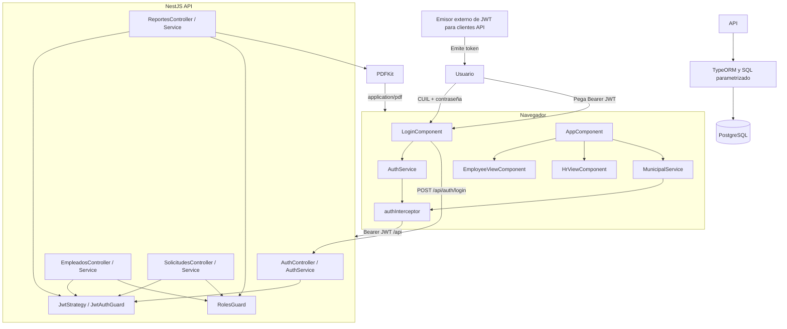
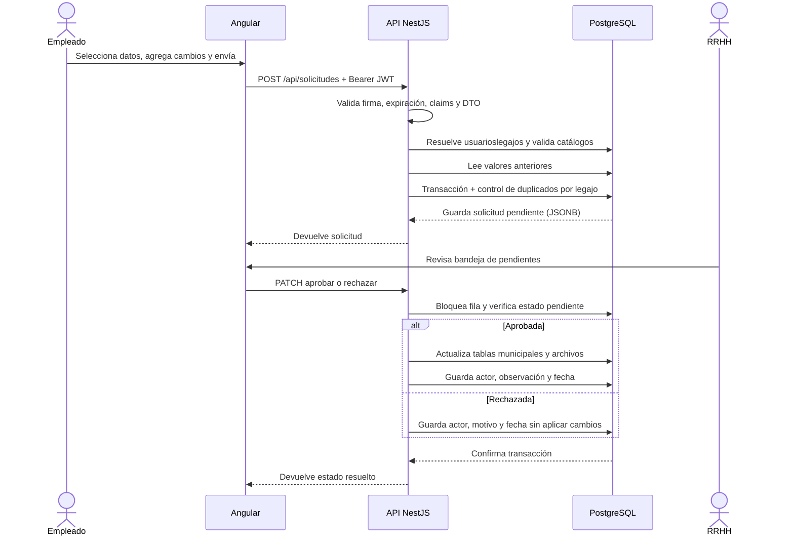
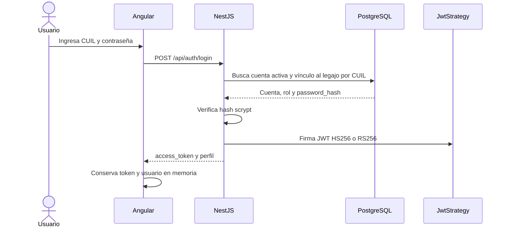
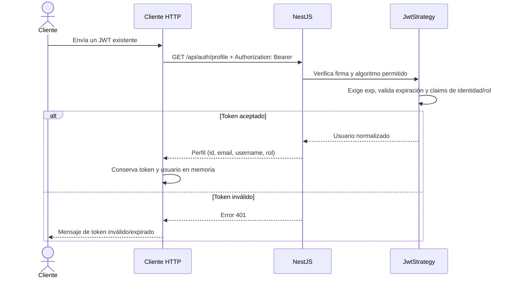
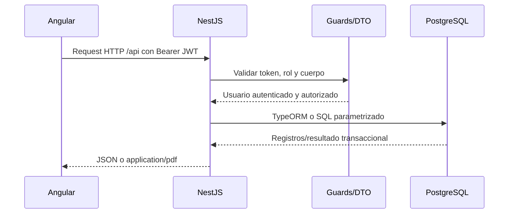

# Documentación técnica

## Alcance

El sistema implementa un portal Angular, una API REST NestJS y persistencia PostgreSQL. El backend autentica cuentas existentes mediante CUIL y contraseña y emite JWT. Esta documentación refleja el código del repositorio; no describe infraestructura productiva ni procesos de despliegue que no estén presentes.

## Arquitectura

### Frontend

- Aplicación Angular 20 basada en componentes standalone.
- `AppComponent` organiza el shell autenticado, navegación en memoria por sección, formularios y operaciones.
- `LoginComponent` solicita CUIL y contraseña y llama `POST /api/auth/login`.
- `AuthService` conserva token y perfil únicamente en memoria.
- `authInterceptor` agrega el encabezado Bearer a las peticiones HTTP.
- `MunicipalService` concentra llamadas REST y adapta respuestas del backend a los modelos de vista.
- `EmployeeViewComponent` presenta la ficha; `HrViewComponent` muestra el panel, listados, bandeja y reportes.
- `proxy.conf.json` dirige `/api` a `http://localhost:3000` durante `ng serve`.

Hay archivos de guardas Angular, pero la aplicación no configura Router: las secciones se controlan por estado. La autorización efectiva de endpoints se realiza en el backend.

### Backend

- NestJS 12, prefijo global `/api`.
- `ValidationPipe` global con `whitelist`, `forbidNonWhitelisted` y `transform`.
- Autenticación Bearer mediante Passport JWT.
- Guards de rol para operaciones exclusivas de RRHH.
- `POST /api/auth/login` verifica el hash de la cuenta activa vinculada al CUIL y emite un JWT.
- Las contraseñas se guardan con scrypt; los JWT se firman con HS256 (`JWT_SECRET`) o RS256 (par de claves).
- TypeORM para entidades y transacciones; algunas consultas del esquema municipal se ejecutan con SQL parametrizado.
- PDFKit para reportes imprimibles.
- CORS limitado a `CORS_ORIGINS`; en producción la variable es obligatoria.
- JSON body predeterminado de 8 MB.

### Base de datos

PostgreSQL 15. `pps_db.sql` define el esquema preexistente de legajos y relaciones. Las migraciones agregan solicitudes y atributos faltantes. TypeORM tiene `synchronize: false`, por lo que el esquema se prepara con SQL y no se modifica al iniciar la API.

Los adjuntos se guardan como `bytea` en `archivos`. El contenido de solicitud y valores anteriores se guarda como `jsonb` en `solicitudes`.

## Diagrama de componentes

El login de la interfaz usa CUIL y contraseña; la aceptación de JWT externos se conserva para clientes de API que ya dispongan de un token.

## Módulos del backend

| Módulo | Responsabilidad |
|---|---|
| `AppModule` | Configura TypeORM y reúne módulos de autenticación, empleados, solicitudes y reportes. |
| `AuthModule` | Registra Passport/JWT, estrategia, perfil normalizado y controlador de perfil. |
| `EmpleadosModule` | Expone consultas de ficha propia y directorio/detalle para RRHH. |
| `SolicitudesModule` | Carga entidades relacionadas y orquesta catálogos, creación, consulta, aprobación y rechazo. |
| `ReportesModule` | Usa el servicio de solicitudes para reunir datos y construir PDF. |
| `common` | Decorador `@User`, `JwtAuthGuard`, `RolesGuard`/`@Roles` y validador de archivos. |
| `config` | Configuración de base y valores de entorno. `database.config.ts` es la configuración usada por `AppModule`. |

## DTOs relevantes

Todos se encuentran en `backend/src/solicitudes/dto/create-solicitud.dto.ts`.

| DTO | Contenido |
|---|---|
| `CreateSolicitudDto` | Requiere el objeto anidado `cambios`, validado como `SolicitudDatosDto`. |
| `SolicitudDatosDto` | Define propiedades admitidas y constraints de domicilio, teléfonos, email, catálogos, familiares, imagen/certificado y CUD. |
| `FamiliarDto` | Valida nombres, tipo/número de documento, sexo, fecha, parentesco, teléfono opcional y discapacidad opcional. |
| `AprobarSolicitudDto` | Observación opcional, texto de hasta 500 caracteres. |
| `RechazarSolicitudDto` | Motivo no vacío y hasta 500 caracteres. |

La capa de servicio vuelve a validar reglas importantes (p. ej., campos admitidos, formatos y contenido de archivos), valida referencias de catálogo y exige al menos un cambio.

## Servicios

### `AuthService`

Autentica con CUIL y contraseña contra cuentas activas vinculadas por `usuarioslegajos`, emite JWT y normaliza identificador, correo, rol y nombre de usuario desde diferentes claims. Devuelve únicamente esos campos normalizados en el perfil.

### `EmpleadosService`

- `findMine`: busca asociación activa usuario-legajo en `usuarioslegajos`.
- `findAll`: consulta y opcionalmente filtra empleados por nombre/apellido; incorpora función y repartición.
- `findDetail`: compone empleado con domicilio, familiares, estudios, CUD, cuenta vinculada y catálogo de estudios.
- `findOne`: obtiene un legajo con sus relaciones de función/repartición.

### `SolicitudesService`

- `findCatalogos`: obtiene reparticiones activas, funciones, parentescos y lista de estados civiles.
- `create`: valida usuario y cambios, resuelve el legajo, toma valores actuales, verifica catálogos y evita duplicados pendientes bajo una transacción con advisory lock por legajo.
- `findAll` / `findOne`: consulta solicitudes y enriquece listado con nombre/estado de empleado y nombres de función/repartición solicitadas.
- `findReportData`: reúne solicitud, empleado, domicilio, foto y nombres de catálogo que necesita el reporte.
- `aprobar`: bloquea la solicitud, verifica que esté pendiente, aplica cambios dentro de una transacción y registra aprobador, observación y fecha.
- `rechazar`: verifica estado/motivo, registra actor, motivo y fecha, sin aplicar cambios al legajo.
- `aplicarCambios` y persistencia asociada: modifica tablas municipales pertinentes y persiste archivos/CUD en el flujo de aprobación.

### `ReportesService`

Usa PDFKit para generar A4, incluye identificador, estado, fechas, datos del legajo, comparación de cambios, observación y paginación. La respuesta se sirve como `application/pdf`.

## Controladores y endpoints expuestos

Todos usan prefijo global `/api`. Salvo health y login, requieren JWT.

| Controlador | Método y ruta | Permiso / operación |
|---|---|---|
| `AppController` | `GET /api/health` | Público; estado básico de API. |
| `AuthController` | `POST /api/auth/login` | Público; valida CUIL y contraseña y emite JWT. |
| `AuthController` | `GET /api/auth/profile` | JWT; devuelve perfil normalizado. |
| `EmpleadosController` | `GET /api/empleados/me` | JWT; ficha del legajo vinculado. |
| `EmpleadosController` | `GET /api/empleados?q=...` | RRHH; listado y filtro. |
| `EmpleadosController` | `GET /api/empleados/:id` | RRHH; ficha por legajo. |
| `SolicitudesController` | `GET /api/solicitudes/catalogos` | JWT; catálogos para formulario. |
| `SolicitudesController` | `POST /api/solicitudes` | JWT y vínculo de legajo; crea solicitud. |
| `SolicitudesController` | `GET /api/solicitudes?estado=pendiente` | RRHH; listado por estado; `all` incluye todos. |
| `SolicitudesController` | `GET /api/solicitudes/:id` | RRHH; detalle. |
| `SolicitudesController` | `PATCH /api/solicitudes/:id/aprobar` | RRHH; aplica cambios y resuelve. |
| `SolicitudesController` | `PATCH /api/solicitudes/:id/rechazar` | RRHH; registra motivo y resuelve. |
| `ReportesController` | `GET /api/reportes/solicitud/:id/pdf` | RRHH; genera PDF inline. |

## Entidades y relaciones

### Esquema municipal base

| Tabla | Propósito y relaciones relevantes |
|---|---|
| `empleados` | Legajo y datos personales; FK opcionales a `funciones`, `reparticiones` y `archivos` (foto). |
| `direcciones` | Domicilio/contacto por legajo; FK a `empleados`. |
| `familiares` | Familiares por legajo; FK a `empleados` y `parentesco`. |
| `funciones` | Catálogo de funciones. |
| `reparticiones` | Catálogo de áreas/reparticiones. |
| `parentesco` | Catálogo de vínculos familiares. |
| `usuarios` | Cuenta y rol de acceso; FK a `roles`. |
| `roles` | Catálogo de roles del sistema externo/base. |
| `usuarioslegajos` | Asociación usuario-legajo; FK a `usuarios` y `empleados`. |
| `archivos` | Metadatos y bytes de archivos; usada por foto y CUD. |
| `emp_cud` | Situación/documento CUD por legajo; FK a `empleados` y `archivos`. |
| `estudios`, `empestudios` | Catálogo de estudios y asociación de estudios a empleados. |

### Entidad de solicitudes

La entidad TypeORM `Solicitud` mapea `solicitudes`: `id` UUID textual, `empleado_id`, tipo, estado, `cambios`/`valores_anteriores` JSONB, fecha de creación y metadatos de aprobación o rechazo (actor, fecha, observación/motivo). `empleado_id` referencia `empleados(legajo)`. El estado inicial es `pendiente`; el servicio lo transiciona a `aprobada` o `rechazada`.

La relación completa figura en `pps_db.sql` y las migraciones `backend/migrations/001_create_solicitudes.sql` a `005_add_password_hash.sql`.

## Flujo completo de una solicitud

### Creación y persistencia

1. Angular agrupa los campos en `cambios` y envía `POST /api/solicitudes`.
2. `JwtAuthGuard` valida el token; `ValidationPipe` rechaza propiedades no permitidas.
3. El servicio valida identificador numérico del usuario, campos, reglas de negocio y bytes de adjuntos.
4. Consulta `usuarioslegajos` por la vinculación activa y obtiene el legajo.
5. Confirma los catálogos y obtiene los valores existentes que se conservarán como referencia.
6. En transacción, toma un advisory lock para el legajo, comprueba que no exista otra solicitud pendiente con campos coincidentes y persiste UUID, `pendiente`, JSON de cambios/valores y fecha.
7. Al aprobar, otra transacción bloquea la solicitud; aplica valores a tablas de legajo y guarda adjuntos cuando corresponde. Al rechazar, almacena motivo y actor, sin tocar datos del legajo.

## Diagramas de autenticación e interacción

### Login con CUIL y contraseña

### Validación de JWT existente

La siguiente secuencia corresponde al endpoint de perfil para integraciones o clientes que ya poseen un JWT; el formulario web usa CUIL y contraseña.

### Frontend, backend y base de datos

## Consideraciones de seguridad

### JWT y autenticación

- El servidor acepta tokens Bearer firmados con los algoritmos configurados en `JWT_ALGORITHM`.
- Se exige `exp`; `JWT_MAX_AGE` limita la antigüedad máxima.
- Para RS256, `JWT_PRIVATE_KEY` firma y `JWT_PUBLIC_KEY` verifica; mantener la clave privada solo en el backend.
- Las contraseñas se guardan en `usuarios.password_hash` como hashes scrypt con sal aleatoria; la API nunca devuelve el hash.
- El CUIL debe identificar una cuenta activa única vinculada a un legajo activo mediante `usuarioslegajos`.
- Se normalizan claims de identidad y rol desde `sub`/`id`/`usuCodigo` y `rol`/`role`/`roles`.
- El cliente guarda el JWT en memoria, no en `localStorage`; cerrar sesión o recargar la pestaña lo descarta.
- `GET /api/auth/profile` valida una credencial ya emitida y devuelve el perfil normalizado.
- Las cuentas locales requieren un rol `1`/RRHH o `2`/Empleado para iniciar sesión. Los tokens heredados pueden omitir el rol, pero no obtienen acceso a las operaciones de RRHH.

### Autorización

- `JwtAuthGuard` protege controladores de empleados, solicitudes y reportes; `GET /health` es público.
- `RolesGuard` limita operaciones de RRHH.
- El acceso del empleado a ficha y creación de solicitud se asocia a `usuarioslegajos` activo; una falta de asociación bloquea esas operaciones.
- No confiar en el filtrado de navegación frontend como control de acceso: el control de API es la frontera efectiva.

### Validación, datos y errores

- CORS utiliza lista explícita de orígenes; se exige en producción.
- DTOs rechazan campos desconocidos mediante `whitelist` y `forbidNonWhitelisted`.
- La API usa parámetros SQL para consultas dinámicas observadas en los servicios.
- Se validan formato, tamaño y firmas binarias de archivos en el flujo de solicitud; máximo 5 MiB. Archivos y datos personales se almacenan en base.
- Los cambios se aplican dentro de transacciones y la solicitud se bloquea al resolverla.
- Se devuelven errores HTTP de validación/autorización/ausencia; algunos errores de persistencia se traducen a mensajes de negocio.
- No se documenta aquí una política completa de auditoría, retención, cifrado en reposo, backup, rate limiting, monitoreo o gestión de secretos productiva: deben definirse antes de exposición real.

### Normalización de catálogos

Las funciones y los parentescos se muestran tal como los entrega `GET /api/solicitudes/catalogos`. La semilla compara nombres sin distinguir acentos y la migración `004_normalize_catalogos.sql` normaliza registros existentes, consolida duplicados (incluido `Cónyuge`/`Conyuge`), repara las referencias de empleados y familiares, y guarda las etiquetas sin acentos para evitar problemas de codificación en la interfaz.
