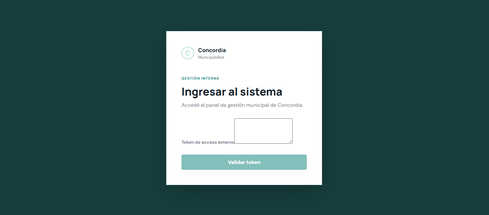
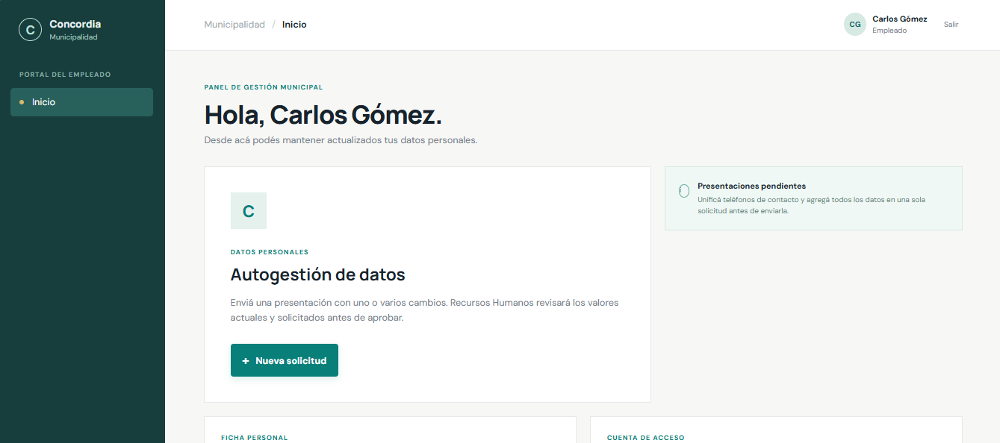
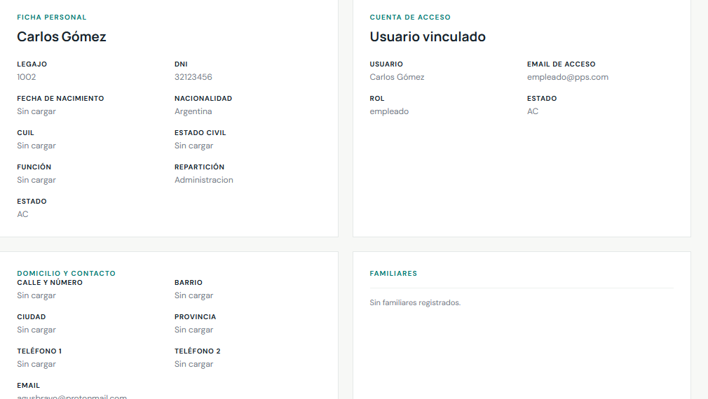
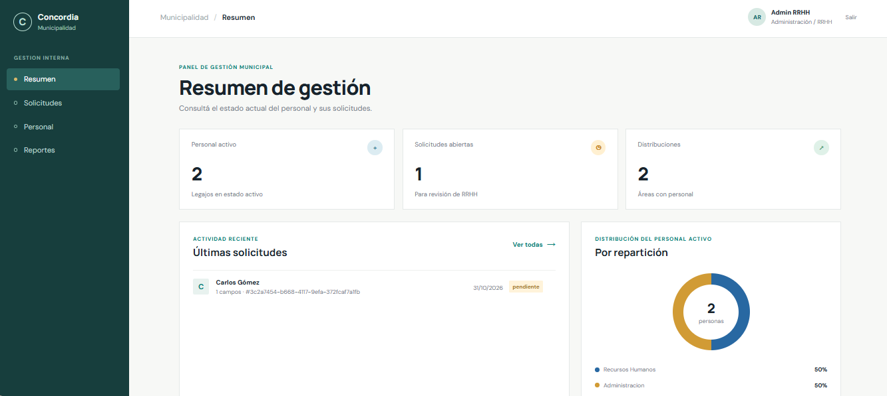
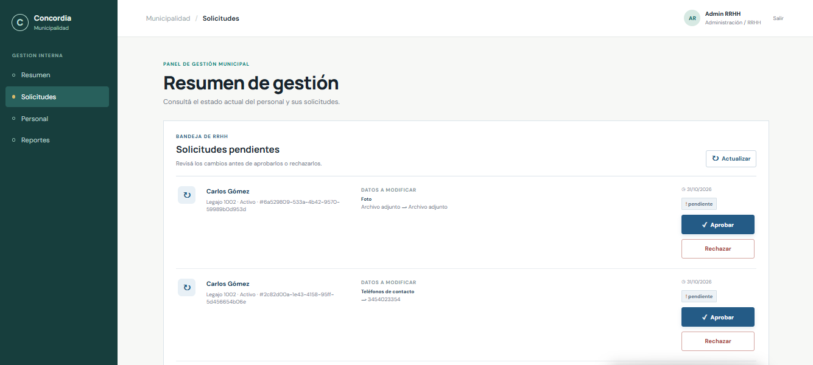
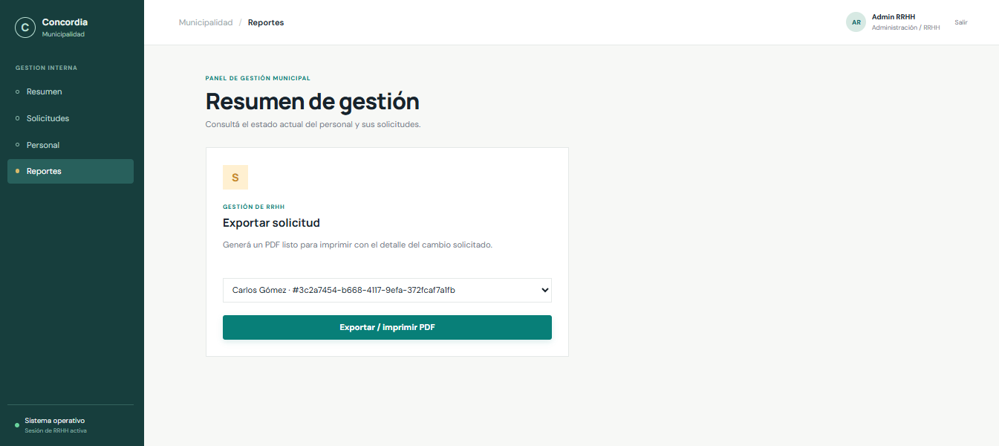
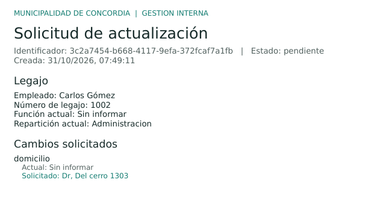

# Manual de usuario

## Introducción

El portal permite al personal municipal consultar los datos asociados a su legajo y presentar una solicitud de actualización. Recursos Humanos dispone de un panel para consultar personal, revisar cambios, resolver solicitudes y generar reportes PDF.

La aplicación usa un token emitido por un proveedor de identidad externo. No se crea una contraseña desde este portal.

## Acceso al sistema

1. Abrir la dirección web comunicada por el administrador.
2. Solicitar al proveedor de identidad institucional un token vigente.
3. Pegar el token en el campo **Token de acceso externo** y seleccionar **Validar token**.
4. Si el token es válido, se abre el inicio correspondiente al rol. Si no lo es o expiró, solicitar uno vigente.

La captura existente muestra el formulario de ingreso con el campo para pegar el token.

**Captura sugerida:** `docs/img/login.png`  
**Qué muestra:** pantalla de acceso y validación de un token externo.  
**Flujo:** obtener token → pegarlo → validarlo → acceder al portal según el rol.

## Navegación principal

### Empleado

El menú presenta **Inicio**. La pantalla contiene el acceso a **Autogestión de datos**, la ficha personal, la cuenta vinculada, domicilio/contacto, familiares, estudios y CUD cuando están disponibles.

**Captura sugerida:** `docs/img/inicio-empleado.png`  
**Qué muestra:** bienvenida, acción para iniciar una solicitud y aviso informativo sobre presentaciones pendientes.  
**Flujo:** ingresar como empleado → revisar la ficha → abrir **Nueva solicitud** para pedir cambios.

La ficha presentada es de consulta. La captura disponible de la ficha permite ilustrar los datos visibles.

**Captura sugerida:** `docs/img/ficha-empleado.png`  
**Qué muestra:** ficha personal y cuenta de acceso, además de datos de domicilio, contacto y familiares.  
**Flujo:** entrar en Inicio → desplazarse por las tarjetas → verificar los datos actuales antes de solicitar una actualización.

### Recursos Humanos

El menú presenta **Resumen**, **Solicitudes**, **Personal** y **Reportes**.

**Captura sugerida:** `docs/img/resumen-rrhh.png`  
**Qué muestra:** indicadores de personal activo, solicitudes abiertas, distribución por repartición y actividad reciente.  
**Flujo:** ingresar con rol RRHH → revisar indicadores → seleccionar la sección del menú que corresponda.

**Captura sugerida:** `docs/img/solicitudes-rrhh.png`  
**Qué muestra:** bandeja de solicitudes pendientes con los cambios solicitados y acciones de aprobación/rechazo.  
**Flujo:** abrir **Solicitudes** → revisar los valores actuales y solicitados → aprobar o iniciar el rechazo indicando motivo.

La vista **Personal** muestra el directorio y un filtro por nombre/apellido. Seleccionar **Reportes** permite elegir una solicitud y abrir su PDF.

**Captura sugerida:** `docs/img/reportes-rrhh.png`  
**Qué muestra:** selección de solicitud y acción para exportar/imprimir PDF.  
**Flujo:** abrir **Reportes** → seleccionar una solicitud → elegir **Exportar / imprimir PDF** → permitir la ventana emergente del navegador.

## Gestión de solicitudes

### Crear una solicitud como empleado

1. En **Inicio**, seleccionar **Nueva solicitud**.
2. Elegir un dato en **Dato a modificar**.
3. Completar el valor o los campos requeridos.
4. Presionar **Agregar dato**. El cambio pasa a la lista temporal de datos incluidos; todavía no fue enviado.
5. Repetir para incorporar otros campos. Se pueden enviar varios cambios juntos. El mismo campo no puede agregarse dos veces a la solicitud en preparación; los familiares se agregan como una lista.
6. Revisar la lista; quitar un cambio si hace falta.
7. Seleccionar **Enviar solicitud completa**.
8. Si la API valida y persiste la presentación, se cierra el formulario. La solicitud queda pendiente de revisión de RRHH.

Los campos disponibles son domicilio, teléfonos, email, repartición, estado civil, familiares, foto, función y CUD. Para CUD, indicar Sí requiere adjuntar certificado; indicar No no solicita archivo.

No se encontró una captura de la ventana de creación. Para la entrega, capturar el formulario abierto y, en otra imagen, el resumen de varios cambios listo para enviar.

**Captura sugerida (pendiente):** `docs/img/formulario-solicitud.png`  
**Qué debería mostrar:** selección de un campo y sus controles asociados.  
**Flujo a capturar:** abrir Nueva solicitud → elegir el campo → completar valor/adjunto → agregar.

**Captura sugerida (pendiente):** `docs/img/solicitud-lista-para-enviar.png`  
**Qué debería mostrar:** varios cambios acumulados y el botón de envío.  
**Flujo a capturar:** agregar datos → revisar/retirar un cambio → enviar la presentación completa.

### Revisar, aprobar o rechazar como RRHH

1. Abrir **Solicitudes**. La bandeja carga solicitudes pendientes.
2. Comparar cada dato actual con el valor solicitado, el legajo y el estado del empleado.
3. Para aprobar, presionar **Aprobar**. El sistema aplica los cambios al legajo y registra aprobador y fecha.
4. Para rechazar, presionar **Rechazar**, escribir un motivo no vacío (máximo 500 caracteres) y confirmar. El motivo queda guardado.
5. La lista se actualiza al finalizar la operación.

Una solicitud que ya no está pendiente no puede resolverse nuevamente desde los endpoints de aprobación/rechazo.

## Formularios

| Dato solicitado | Comportamiento y validación visible/servidor |
|---|---|
| Domicilio | Texto de al menos 5 caracteres y máximo 255. |
| Teléfono | Debe respetar el formato telefónico aceptado. |
| Teléfonos de contacto | Uno o dos teléfonos separados por coma. |
| Correo electrónico | Debe tener formato de email. |
| Repartición / función | Elegir un elemento de los catálogos cargados. |
| Estado civil | Elegir una opción del catálogo servido por la API. |
| Familiares | Completar apellido, nombre, tipo/número de documento, sexo, nacimiento y parentesco; teléfono opcional. Se valida contra el catálogo de parentescos. |
| Foto | JPG, PNG o WEBP; límite de 5 MB. |
| CUD | Responder Sí/No. Si Sí, adjuntar JPG, PNG, WEBP o PDF de hasta 5 MB. |

El servidor vuelve a validar los datos, los campos permitidos, los catálogos y la firma de formato de los adjuntos. Los mensajes de rechazo de la API aparecen en el formulario.

**Captura sugerida (pendiente):** `docs/img/formulario-solicitud.png`  
**Qué debería mostrar:** controles del formulario para el dato elegido y sus requisitos.  
**Flujo:** abrir Nueva solicitud → elegir el campo → completar valor o adjunto → agregar el cambio.

## Listados y reportes

- **Personal:** permite filtrar el directorio por nombre/apellido; en la interfaz el campo de búsqueda también presenta el área.
- **Solicitudes:** muestra las pendientes en la bandeja. La sección de reportes obtiene todos los estados.
- **Reportes:** genera un PDF con los datos del empleado, cambios solicitados y, cuando corresponde, observación de RRHH.
- **Ficha del empleado:** se consulta desde Inicio; no es una edición directa.

La imagen `docs/img/reporte-solicitud.png` es una página de ejemplo del PDF emitido.

**Captura sugerida:** `docs/img/reporte-solicitud.png`  
**Qué muestra:** identificador y estado de la presentación, legajo y valores actual/solicitado.  
**Flujo:** RRHH abre Reportes → elige la solicitud → solicita el PDF → visualiza/guarda/imprime el documento.

## Validaciones y mensajes

- Un token ausente, inválido o expirado impide acceder.
- El rol RRHH es necesario para directorio, detalle/listado de solicitudes, resolución y PDF.
- Para crear solicitudes, la identidad debe asociarse a un legajo activo.
- No se pueden enviar solicitudes sin cambios ni campos ajenos a la lista permitida.
- El backend evita solicitudes pendientes duplicadas para el mismo campo y legajo.
- Los errores de conexión, autorización y validación se notifican en pantalla; ante expiración o falta de autorización, volver a ingresar.
- El portal no presenta una sección de historial para que el empleado consulte el estado de solicitudes anteriores.

**Captura sugerida (pendiente):** `docs/img/validacion-formulario.png`  
**Qué debería mostrar:** un mensaje visible de validación (por ejemplo, teléfono inválido o archivo de tipo/tamaño no admitido), sin datos personales.  
**Flujo:** abrir el formulario → ingresar un valor inválido → observar el mensaje → corregirlo y continuar.

## Cierre de sesión

Seleccionar **Salir**, en la barra superior. Se borra el token de la memoria de la aplicación y se vuelve al formulario de acceso. La sesión también se pierde al recargar la pestaña porque el token no se guarda en almacenamiento persistente del navegador.

**Captura sugerida:** `docs/img/login.png` (capturar nuevamente luego de seleccionar Salir si se quiere documentar el resultado del flujo).  
**Qué muestra:** pantalla de ingreso que queda disponible luego de cerrar la sesión.  
**Flujo:** seleccionar Salir → confirmar que reaparece el formulario → comprobar que el token anterior ya no habilita la sesión.

## Nota sobre capturas

Las imágenes disponibles corresponden a pantallas representativas, pero algunas incluyen nombres y otros datos personales. Anonimizarlos antes de entregar o publicar el repositorio. No hay una captura disponible de creación de solicitud ni de contenedores Docker; véase [CAPTURAS.md](CAPTURAS.md).
